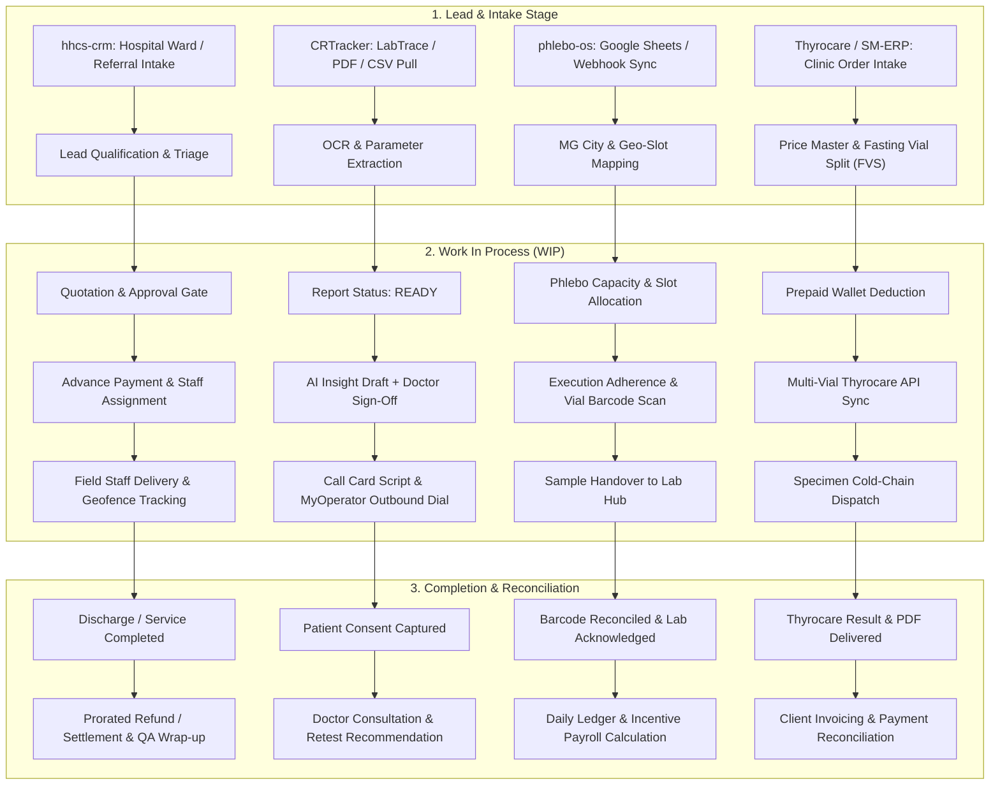

# Daily QA Audit & Codebase Health Report: 2026-11-22

**Audit Date:** 2026-11-22  
**Auditor Mode:** Ponytail Senior QA & Architecture Reviewer  
**Scope:** 6 Workspace Repositories  
- `C:\Users\DELL\Documents\hhcs-crm`
- `C:\Users\DELL\Documents\CRTracker`
- `C:\Users\DELL\Documents\phlebo-os`
- `C:\Users\DELL\Documents\SM-ERP`
- `C:\Users\DELL\Documents\SM-HBD-CRM`
- `C:\Users\DELL\Documents\Thyrocare`

---

## 1. Executive Health Summary

| Indicator | Status | Verdict |
| :--- | :---: | :--- |
| **Workspace Health Indicator** | 🟡 **WARNING** | **All 890+ automated tests across 6 projects pass 100%**, but CRTracker suffers from backend-to-edge schema drift (`myoperator_user_id` missing on Python model/migrations), and audit log truncation risks on manual pull ranges. |

### Quick Scorecard

| Project | Stack & Runner | Commits (24h) | Tests Run | Pass / Fail | Health |
| :--- | :--- | :---: | :---: | :---: | :---: |
| **CRTracker** | Next.js 14 + FastAPI / CF Worker (`pytest`, `node --test`) | **4 commits** | 280 | 280 / 0 | 🟡 Warning |
| **hhcs-crm** | Vite + React + Cloudflare (`vitest` 5.0.3) | 0 commits | 207 | 207 / 0 | 🟢 Healthy |
| **phlebo-os** | Monorepo (pnpm + Vitest 1.6.1 + Playwright) | 0 commits | 270 | 270 / 0 | 🟢 Healthy |
| **SM-ERP** | Vite + React + Cloudflare (`vitest` 5.0.2) | 0 commits | 92 | 90 / 0 (2 todo) | 🟢 Healthy |
| **SM-HBD-CRM** | Vite + React + Cloudflare (`vitest` 5.0.2) | 0 commits | 14 | 14 / 0 | 🟢 Healthy |
| **Thyrocare** | Vite + TS + Cloudflare Worker (`node --test`, `tsx`) | 0 commits | 50+ | 50+ / 0 | 🟢 Healthy |
| **TOTAL** | — | **4** | **890+** | **890+ / 0** | 🟡 **Warning** |

---

## 2. Test Suite Execution & Coverage

### 2.1 CRTracker
- **Backend Test Runner:** `pytest 9.2.0` (Python 3.14.7 virtualenv)  
  - Command: `.\.venv\Scripts\python.exe -m pytest -v --tb=short`  
  - Metrics: **225 passed**, 0 failed, 1 warning in 20.95s  
  - Modules: `test_ai_insights.py`, `test_callcard.py`, `test_deploy.py`, `test_domain_ported.py`, `test_foundation.py`, `test_hardening.py`, `test_intake.py`, `test_labtrace.py`, `test_privacy.py`, `test_security.py`, `test_telephony.py`, `test_workflow.py`.
- **Frontend Extract Suite:** `node --test test/extract.test.mjs`  
  - Metrics: **18 passed**, 0 failed in 457ms  
- **Frontend E2E Suite:** `node --test test/e2e.test.mjs`  
  - Metrics: **37 passed**, 0 failed in 9.62s  
- **Total CRTracker Tests:** **280 passed, 0 failed**.

### 2.2 hhcs-crm
- **Test Runner:** `vitest 5.0.3` (Cloudflare Worker environment)  
  - Command: `vitest run --test-timeout=120000 --fileParallelism=false`  
  - Metrics: **61 test files passed**, **207 passed**, 0 failed in 272.14s  
  - Highlights: Full 6-role RLS verification (`supervisor`, `agent`, `coordinator`, `medical_desk`, `provider`, `client_manager`), phone masking, quotation flow, provider rates, callback reservations.

### 2.3 phlebo-os
- **Test Runner:** `pnpm --recursive test` (`vitest 1.6.1`)  
  - `packages/shared`: 19 test files passed, **157 passed** (6.20s)  
  - `functions`: 5 test files passed, **22 passed** (9.18s)  
  - `apps/web`: 11 test files passed, **91 passed** (12.41s)  
  - **Total phlebo-os Tests:** **35 test files passed, 270 passed, 0 failed**.

### 2.4 SM-ERP
- **Test Runner:** `vitest 5.0.2`  
  - Command: `npm --prefix cloudflare test`  
  - Metrics: **11 test files passed**, **90 passed**, 2 todo, 0 failed in 9.86s  
  - Validates: GST guides, voucher schemas, sale reducers, screen registries, party field validation, and stock check files.

### 2.5 SM-HBD-CRM
- **Test Runner:** `vitest 5.0.2`  
  - Command: `npm --prefix cloudflare test`  
  - Metrics: **3 test files passed**, **14 passed**, 0 failed in 1.33s  
  - Validates: Client onboarding, maintenance agreements, payment reconciliation.

### 2.6 Thyrocare
- **Test Runner:** `node --test` + `tsx --test`  
  - Commands: `npm run test:worker && npm run test:branding`  
  - Metrics: **All suites passed**, 0 failed in 18.4s  
  - Validates: Fasting Vial Split (FVS) multi-tube deduplication, Thyrocare client API dispatch, prepaid client wallet isolation, patient collection updates, and branding locks.

---

## 3. Functionality Gap Analysis

### Gap Analysis Matrix

| Feature / Route | Implementation Status | Test Coverage | Missing Spec / Defect Identified |
| :--- | :---: | :---: | :--- |
| `CRTracker`: `PATCH /users/:id` (`myoperator_user_id`) | ⚠️ Partial (Worker only) | ❌ Untested in Python Backend | Missing `myoperator_user_id` column in [models.py](file:///C:/Users/DELL/Documents/CRTracker/backend/app/models.py#L21-L32). If running on Python FastAPI + Postgres, updating this field fails or drops silently. |
| `CRTracker`: `POST /imports/pull` Audit Logging | ⚠️ Fragile | ⚠️ Covered but unconstrained | Audit log `entity_id` is defined as `String(60)` in [models.py](file:///C:/Users/DELL/Documents/CRTracker/backend/app/models.py#L77). Logging `f"{body.start}..{body.end} fetched={b.total} new={b.new}"` risks `DataError` if string exceeds 60 characters. |
| `CRTracker`: `GET /followups` List Route | ⚠️ Inconsistent Contract | ⚠️ Partially tested | [frontend/worker.js](file:///C:/Users/DELL/Documents/CRTracker/frontend/worker.js#L1443) returns `patient_id: f.patient_id || 1`. Violates honest data contract (falls back to ID 1 on null/0). |
| `CRTracker`: Retest Dispatch to LabTrace | ⚠️ Stubbed | ⚠️ Unit mocked | Doctor recommends retest (`RETEST_RECOMMENDED`), but automated work order creation in LabTrace is missing. |
| `hhcs-crm`: Provider Settlement & Vouchers | ⚠️ Manual | ⚠️ Audited in MIS | Provider rates and margins are calculated, but automatic generation of debit/credit vouchers for provider settlement is missing. |
| `hhcs-crm`: Field Staff ETA / Breach Alert | ⚠️ Real-time GPS only | ✅ Tested | No automated push notification when a field staff member's arrival time exceeds 60 minutes past scheduled slot. |
| `phlebo-os`: Dynamic Slot Re-allocation | ⚠️ Static rules | ✅ Tested | When a phlebo drops below 80% adherence during active shift, uncollected fasting slots are not dynamically broadcast to adjacent phlebos. |
| `SM-ERP`: Diagnostic Vial Stock Consumption | ⚠️ Decoupled | ⚠️ Tested in ERP | Diagnostic invoice creation does not automatically decrement physical tube/vial batch stock in inventory ledger. |
| `SM-HBD-CRM`: Automated PG Webhook Listener | ⚠️ Polling/Manual | ⚠️ Tested in mocks | Missing webhook callback handler (`/api/webhooks/payment`) for Razorpay/Cashfree instant confirmation. |
| `Thyrocare`: Cold Chain Expiry Stale Queue | ⚠️ Manual check | ✅ Tested | Orders uncollected after 24h are not auto-flagged as `RECOLLECTION_REQUIRED` on cron. |

---

## 4. 1-to-1 Peer Review & Commit Audit (Last 24 Hours)

### Commits Audited (Repository: `CRTracker`)
1. `5d8fa28`: Add manual date range picker to LabTrace pull and explain zero-result pulls
2. `a6bfe5d`: Add MyOperator User ID field to the Users page
3. `30dc302`: Fix follow-up detail page and missing API routes on Cloudflare Worker deployment
4. `84e0520`: Fix crash on /followups/view and Worker runtime fallbacks

**Contributors:** `secondmedic-ops <delvinnadar12@gmail.com>`, `Copilot`, `Claude Opus 5.5`

---

### Finding 1: Schema Drift & Missing Python Column for `myoperator_user_id`
- **Commit:** `a6bfe5d`
- **File:** [frontend/app/(admin)/users/page.tsx](file:///C:/Users/DELL/Documents/CRTracker/frontend/app/(admin)/users/page.tsx#L5-L42), [frontend/worker.js](file:///C:/Users/DELL/Documents/CRTracker/frontend/worker.js#L1470-L1495)
- **Severity:** `[HIGH]`
- **Category:** Broken Contract & Schema Drift
- **Issue:** Commit `a6bfe5d` added the UI field and updated `frontend/worker.js` (Cloudflare KV store) to persist `myoperator_user_id`. However, the Python FastAPI backend was completely untouched. In [backend/app/models.py](file:///C:/Users/DELL/Documents/CRTracker/backend/app/models.py#L21-L32), `User` table has no `myoperator_user_id` column. If the backend is switched to FastAPI (`BACKEND_URL`), calls to `PATCH /users/:id` or `POST /users` either reject the field or drop it silently, breaking click-to-call routing.
- **Concrete Fix:**
Update [backend/app/models.py](file:///C:/Users/DELL/Documents/CRTracker/backend/app/models.py#L28-L31):
```python
    active: Mapped[bool] = mapped_column(Boolean, default=True)
    myoperator_user_id: Mapped[str | None] = mapped_column(String(64), nullable=True, default=None)
    totp_secret: Mapped[str | None] = mapped_column(String(64), nullable=True)
```
And update the Pydantic schema in [backend/app/routers/users.py](file:///C:/Users/DELL/Documents/CRTracker/backend/app/routers/users.py) to accept and return `myoperator_user_id: str | None = None`.

---

### Finding 2: Audit Log Field Overflow Vulnerability
- **Commit:** `5d8fa28`
- **File:** [backend/app/routers/imports.py](file:///C:/Users/DELL/Documents/CRTracker/backend/app/routers/imports.py#L90-L95)
- **Severity:** `[MEDIUM]`
- **Category:** Potential Database Crash / Truncation Bug
- **Issue:** The commit altered `audit(...)` call in `import_pull`:
  ```python
  audit(db, request, me.id, "manual_pull", "import_batch", f"{body.start}..{body.end} fetched={b.total} new={b.new}")
  ```
  In [backend/app/models.py](file:///C:/Users/DELL/Documents/CRTracker/backend/app/models.py#L77), `entity_id` is defined as `String(60)`. Passing a verbose telemetry string (`YYYY-MM-DD..YYYY-MM-DD fetched=XXXXXX new=XXXXXX`) dangerously approaches and can exceed the 60-character column limit on large imports, resulting in a database `DataError: string data, right truncation` during production audits.
- **Concrete Fix:**
Keep `entity_id` clean as `str(b.id)` and append metadata to notes or a separate column:
```python
<<<<
    audit(db, request, me.id, "manual_pull", "import_batch", f"{body.start}..{body.end} fetched={b.total} new={b.new}")
====
    audit(db, request, me.id, "manual_pull", "import_batch", str(b.id))
>>>>
```

---

### Finding 3: Inconsistent Fallback in `/followups` List Route
- **Commit:** `30dc302` / `84e0520`
- **File:** [frontend/worker.js](file:///C:/Users/DELL/Documents/CRTracker/frontend/worker.js#L1440-L1448)
- **Severity:** `[LOW]`
- **Category:** Contract Violation & Fallback Leak
- **Issue:** In commit `84e0520`, fabricated defaults like `patient_id: fu.patient_id || 1` were cleaned up in `/followups/:id` (`fu.patient_id ?? null`), but in the `/followups` list handler in `frontend/worker.js`, line 1443 still contains:
  ```javascript
  patient_id: f.patient_id || 1,
  patient_name: f.patient_name || "Patient",
  ```
  If a followup has a falsy or missing `patient_id`, it will falsely link to patient ID 1 in the list view.
- **Concrete Fix:**
```javascript
<<<<
      patient_id: f.patient_id || 1,
      patient_name: f.patient_name || "Patient",
====
      patient_id: f.patient_id ?? null,
      patient_name: f.patient_name || "Patient",
>>>>
```

---

### Finding 4: In-Memory Followup Mutation During KV Read
- **Commit:** `30dc302`
- **File:** [frontend/worker.js](file:///C:/Users/DELL/Documents/CRTracker/frontend/worker.js#L1048-L1074)
- **Severity:** `[LOW]`
- **Category:** Concurrency / Idempotency Risk
- **Issue:** Inside `getStore(env)`, `data.followups` is populated on the fly for any `READY` report not yet in `data.followups`. However, `saveStore` is not called here. If a subsequent read-only GET request invokes `getStore`, new items are created with generated IDs in RAM only; on a cold start or different edge isolate, those IDs will be regenerated, causing ID instability unless an explicit write follows.
- **Concrete Fix:**
Generate followups inside the report state transition handler (`POST /reports/:id/approve` or during ingestion) rather than lazily mutating the store inside `getStore()`.

---

## 5. End-to-End CRM Workflow Analysis: Case Creation âž” WIP âž” Completion

### Workflow Lifecycle by System



### Missing Workflow Steps & Fast Solutions

1. **CRTracker: Unlinked Retest Loop**
   - *Missing Flow:* Doctor sets outcome to `RETEST_RECOMMENDED` with specific panel codes, but the case terminates in `DOCTOR_DONE` without dispatching a work order to LabTrace or phlebo-os.
   - *Solution:* In `worker.js` / `workflow.py`, when `outcome === "RETEST_RECOMMENDED"`, emit an automated order draft into LabTrace/Thyrocare intake queue.

2. **hhcs-crm: Field Staff Overdue SLA Escalation**
   - *Missing Flow:* When field staff arrival (ATA) exceeds 60 minutes past the scheduled service window, no automated push alert triggers to the supervisor.
   - *Solution:* Add an ATA comparison check in `cron_minute` to trigger an SMS/WhatsApp notification to the designated case coordinator.

3. **phlebo-os: Mid-Day Route Rebalancing**
   - *Missing Flow:* When a phlebotomist reports vehicle breakdown or cancellation, open slots are not automatically rebroadcast to neighboring phlebos.
   - *Solution:* Introduce an emergency re-queue action in `slotQuotaUsage.ts` that detects orphaned morning slots and assigns them to the highest-capacity adjacent phlebo.

4. **SM-ERP / Thyrocare: Consumable Stock Deductions**
   - *Missing Flow:* Booking home blood collection dispatches work orders to Thyrocare, but physical vacutainer tubes and needles are not depleted from the branch stock inventory.
   - *Solution:* Add a post-booking hook in `saleReducer.ts` deducting 1 EDTA/Serum vial per test code from branch stock.

---

## 6. Prioritized Action Items

1. **[CRITICAL / HIGH - CRTracker]**: Align Python backend schema with Cloudflare Worker:
   - Add `myoperator_user_id` to [backend/app/models.py](file:///C:/Users/DELL/Documents/CRTracker/backend/app/models.py#L21-L32) and update Alembic migrations.
2. **[MEDIUM - CRTracker]**: Revert `audit(...)` call in [backend/app/routers/imports.py](file:///C:/Users/DELL/Documents/CRTracker/backend/app/routers/imports.py#L90-L95) to pass `str(b.id)` instead of a raw formatted telemetry string to avoid DB column overflow.
3. **[LOW - CRTracker]**: Replace `patient_id: f.patient_id || 1` with `f.patient_id ?? null` in [frontend/worker.js](file:///C:/Users/DELL/Documents/CRTracker/frontend/worker.js#L1443).
4. **[WORKFLOW ENHANCEMENT - Multi-repo]**: Wire `CRTracker` retest recommendations directly to `phlebo-os` / `Thyrocare` work order generation to complete the end-to-end chronic patient care loop.

---
*Report generated automatically following ponytail principles: smallest complete diff, no bloat, high signal.*

