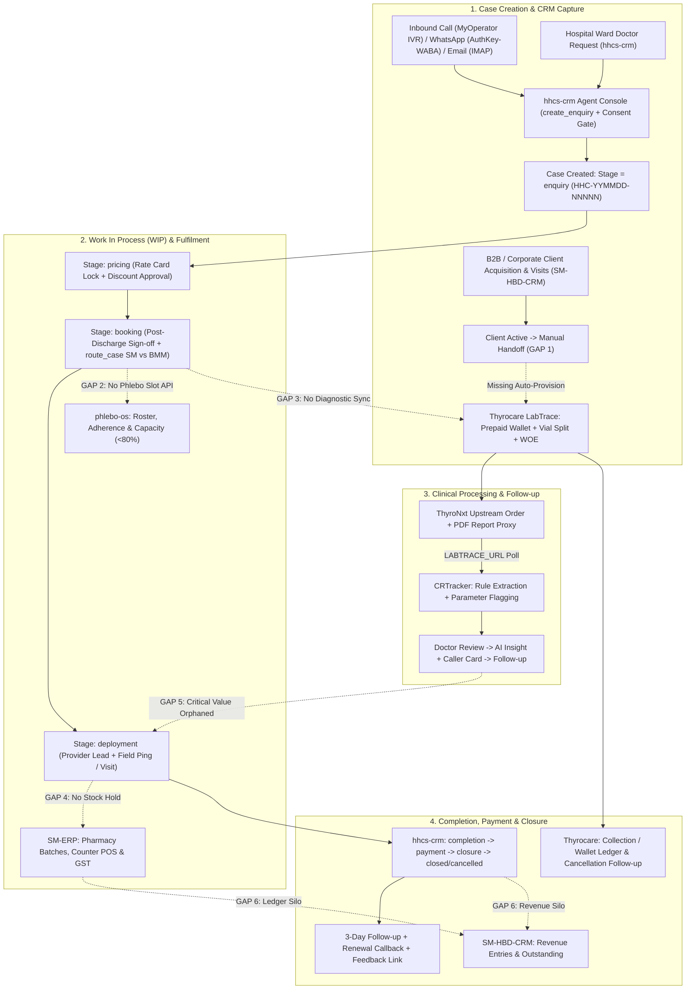

# Daily Automated QA Audit & Codebase Health Report

**Audit Date:** 2026-11-26 (`2026-11-26T10:00+05:30`)  
**Scope:** All 6 Workspace Projects  
- `hhcs-crm` (`C:\Users\DELL\Documents\hhcs-crm`, branch `main`)
- `CRTracker` (`C:\Users\DELL\Documents\CRTracker`, branch `main`)
- `phlebo-os` (`C:\Users\DELL\Documents\phlebo-os`, branch `master`)
- `SM-ERP` (`C:\Users\DELL\Documents\SM-ERP`, branch `main`)
- `SM-HBD-CRM` (`C:\Users\DELL\Documents\SM-HBD-CRM`, branch `main`)
- `Thyrocare` (`C:\Users\DELL\Documents\Thyrocare`, branch `feat/worker-typescript-remove-java`)

---

## 1. Executive Health Indicator

**Overall Workspace Status:** [🟡 WARNING] — **1,009 counted automated tests passed (0 failures, 2 `todo`) + 2 standalone test scripts passed**, TypeScript checks passed on 5 projects, **however** 24-hour commits in `SM-HBD-CRM` introduced a `[HIGH]` UI-API contract violation on Staff cost entry, `Thyrocare` root `tsc --noEmit` hung >139s, `CRTracker`/`phlebo-os`/`Thyrocare` hold large uncommitted diffs, and `SM-ERP` carries 126 stubbed menu features plus unresolved merge markers in `PROJECT.md`.

| Project | Health | Primary Stack | Commits (24h) | Tests Passed | Failed / Todo | TypeCheck (`tsc`) | Key Risk / Note |
| :--- | :---: | :--- | :---: | :---: | :---: | :---: | :--- |
| **hhcs-crm** | 🟢 **HEALTHY** | React 18 + Vite + CF Worker + Supabase/PGlite | **5** | **229** (68 files) | 0 / 0 | Pass (Root + CF) | Clean 24h fixes; minor concurrency & consent-key edge in `create_enquiry`. |
| **CRTracker** | 🟡 **WARNING** | Next.js + CF Worker + FastAPI (Py 3.14) | 0 | **280** (225 BE + 55 FE) | 0 / 0 | N/A | `worker.js` line coverage 51.05%; `connect-doctor` stub; 20 dirty files. |
| **phlebo-os** | 🟡 **WARNING** | pnpm monorepo: React + Firebase Functions + CF Edge | 0 | **270** (35 files) | 0 / 0 | Pass (5 pkgs) | 4 permissioned routes render placeholder; `test:rules` unrun; 10 dirty files. |
| **SM-ERP** | 🟡 **WARNING** | React 19 + Vite + CF Worker + Supabase | 0 | **90** (11 files) | 0 / **2 todo** | Pass (Root + CF) | 126 `TODO` menu nodes; git conflict in `PROJECT.md`; boilerplate `example.spec.js`. |
| **SM-HBD-CRM** | 🟡 **WARNING** | React + Vite + CF Worker + Supabase | **3** | **14** (3 files) | 0 / 0 | Pass (Root + CF) | `[HIGH]` Staff cost forced in UI yet dropped on API; filter collision in Outstanding. |
| **Thyrocare** | 🟡 **WARNING** | React + Capacitor + CF Worker (D1/SQLite) | 0 | **126** (+2 scripts) | 0 / 0 | Worker Pass / **Root Hung** | Root `tsc` >139s; `slip.size_bytes` client-trusted; 3 test files excluded from `npm test`; 99 dirty files. |

---

## 2. Test Suite Execution & Coverage Summary

All suites were executed cleanly in isolated project directories. Coverage flags were applied where supported natively (`node --test --experimental-test-coverage` on `CRTracker` FE); `@vitest/coverage-v8` and `pytest-cov` are not installed in the Vitest/pytest environments.

| Project / Component | Runner & Command | Suites / Files | Passed | Failed | Skipped / Todo | Duration | Coverage / Notes |
| :--- | :--- | :---: | :---: | :---: | :---: | :---: | :--- |
| **hhcs-crm** (CF/DB) | `vitest run --test-timeout=120000 --fileParallelism=false` | 68 files | **229** | 0 | 0 | 857.02s | `@vitest/coverage-v8` not installed. Real PGlite migrations verified. |
| **CRTracker** (Backend) | `.venv\Scripts\python.exe -m pytest -v` | 16 files | **225** | 0 | 0 | 95.47s | `pytest-cov` not installed. 1 Starlette deprecation warning. |
| **CRTracker** (Frontend) | `node --test --experimental-test-coverage test/extract.test.mjs test/e2e.test.mjs` | 6 suites | **55** | 0 | 0 | 22.77s | **59.86% lines / 61.64% branches / 51.24% funcs** (`extract.js`: 99.15% line; `worker.js`: 51.05% line). |
| **phlebo-os** (`shared`) | `pnpm --recursive test` (`vitest run`) | 19 files | **157** | 0 | 0 | 16.36s | `@vitest/coverage-v8` not installed. |
| **phlebo-os** (`web`) | `pnpm --recursive test` (`vitest run`) | 11 files | **91** | 0 | 0 | 28.80s | `@vitest/coverage-v8` not installed. |
| **phlebo-os** (`functions`) | `pnpm --recursive test` (`vitest run`) | 5 files | **22** | 0 | 0 | 25.52s | `@vitest/coverage-v8` not installed. |
| **SM-ERP** (CF) | `npx vitest run` | 11 files | **90** | 0 | **2 todo** | 11.77s | `todo`s in `globalStore.test.ts:71` and `screenRegistry.test.ts:55`. |
| **SM-HBD-CRM** (CF) | `npx vitest run` | 3 files | **14** | 0 | 0 | 2.50s | `@vitest/coverage-v8` not installed. |
| **Thyrocare** (`test:worker`) | `tsx --test --test-concurrency=1 ...` | 18 TAP + 2 scripts | **110** (+2 scripts) | 0 | 0 | 16.24s+ | `patientCollection.test.js` & `workOrderIsolation.test.js` exited 0 (non-TAP). |
| **Thyrocare** (`test:branding`) | `node --test scripts/check-branding.test.mjs` | 1 file | **1** | 0 | 0 | 0.72s | Branding guard passed. |
| **Thyrocare** (`cancellation`) | `npm run test:cancellation-followup` (`tsx --test`) | 1 suite | **5** | 0 | 0 | 1.27s | Not wired into `npm test`. |
| **Thyrocare** (`src/lib` extra) | `npx tsx --test src/lib/collections.test.ts src/lib/patientCollections.test.ts` | 2 files | **10** | 0 | 0 | 0.90s | Not wired into `npm test`. |
| **TOTAL (Executed)** | — | **156+** | **1,009** (+2 scripts) | **0** | **2 todo** | — | **Zero test failures; 1 `tsc` hang (`Thyrocare` root).** |

**Not Executed (Environment / Scope Gates):**
- `hhcs-crm`: `npm run rehearse` (7 `*.itest.mjs` files spawning `wrangler dev`) and `npm run e2e` (8 Playwright specs).
- `SM-ERP` & `SM-HBD-CRM`: `npm run rehearse` (`test/api.itest.mjs`); `SM-ERP` Playwright (`tests/example.spec.js` is starter boilerplate).
- `phlebo-os`: `pnpm run test:rules` (requires Firebase Emulator) and `e2e/portal-go-live.spec.ts`.
- `Thyrocare`: `npm run test:ui` (`scripts/ui-smoke.cjs`) and root `npx tsc --noEmit` (timed out >139s).

---

## 3. Functionality Gap Analysis Matrix

| Feature / Route / Module | Project | Implementation Status | Test Coverage | Missing Spec / Gap Identified | Short Recommended Fix |
| :--- | :--- | :--- | :--- | :--- | :--- |
| **Staff Cost Entry vs API** | `SM-HBD-CRM` | 🔴 Broken Contract (`RevenueEntriesTab.tsx:L115,L142`, `revenue.ts:L229`) | 0% (FE/BE mismatch) | UI requires `STAFF` to enter `Cost (₹)`, but Worker silently writes `0` on create, keeps `old.cost` on edit, and returns `null`. | Align rule: either persist `STAFF` entered cost (and keep profit hidden) or restore `role !== 'Staff'` hide/omit in `RevenueEntriesTab.tsx`. |
| **Masters / Rx / Reports Menus** | `SM-ERP` | 🔴 Stubbed (126 `TODO` nodes) | 2 `todo` Vitest specs | `mastersMenu.ts` (11), `prescriptionMenu.ts` (26), and `reportsMenu.ts` (89) render `TODO(...)` stubs (`Reverse Charge on Expences`, `Prescription New/Pending`, `Mode of Payment`, etc.). | Prioritize `Prescription New/Pending` & `Mode of Payment` into active `BillScreen` POS flow; hide unbuilt `TODO` nodes behind a feature flag. |
| **Payroll / Warnings / Perf / Reports UI** | `phlebo-os` | 🟡 Partial (`App.tsx:58-86`, `permissions.ts:15-18`) | BE `payroll`/`scoring` unit tested; FE 0% | `ROUTE_PERMISSIONS` grants `/performance`, `/warnings`, `/payroll`, `/reports`, but `App.tsx` falls through to `"Phase 1-4 Foundation Ready"` placeholder. | Wire dedicated views to `processMonthlyPayroll` / scoring hooks or remove unbuilt paths from `ROUTE_PERMISSIONS` until shipped. |
| **Doctor Tele-Consult Bridge** | `CRTracker` | 🟡 Stubbed (`workflow.py:185-198`) | Mock notification test only | `# ---- connect doctor now (stub) ----` only creates an in-app notification and returns doctor phone; no automated two-leg call bridge. | Invoke `MyOperatorDialer.call_customer()` in `connect_doctor` to bridge caller/patient and doctor automatically. |
| **Synchronous 90-Day Lab Pull** | `CRTracker` | 🟡 Risky (`imports.py:90-97`) | Unit tested (mock) | `POST /imports/pull` synchronously pulls up to 90 days in-request, risking CF Worker subrequest/CPU timeouts. | Lower synchronous limit to 14–30 days or dispatch large date windows to an async background worker/queue. |
| **Edge Worker Test Coverage** | `CRTracker` | 🟡 Partial (`frontend/worker.js`) | **51.05%** lines | Lines 791–1004, 1225–1443, 2417–2568 (auth/proxy/backfill branches) lack test execution in `test:e2e`. | Add `node --test` integration cases covering Edge Worker proxy fallbacks and error paths. |
| **AI Command & Case Brief Endpoints** | `hhcs-crm` | 🟢 Implemented (`routes.ts:74-75`) | 0% (`test/` & `e2e/`) | `/api/v1/ai/command` and `/api/v1/ai/cases/{id}/brief` have zero automated Vitest or `.itest.mjs` coverage. | Add Vitest specs with mocked Gemini fetch verifying role checks, truncation, and `c.changed` propagation. |
| **Wallet Slip Size & AI Quota Flag** | `Thyrocare` | 🟡 Partial (`walletRoutes.ts:127-137`) | Tested w/ happy-path payload | `walletRoutes.ts:127` trusts client `slip.size_bytes` before fallback; `slipExtractor.ts` logs quota skip without flagging deposit for manual review. | Compute size strictly from `image_data` base64 length and append `[OCR skipped]` note when AI extraction fails/skips. |
| **Unwired Tests & Hung Root `tsc`** | `Thyrocare` | 🟡 Config Drift (`package.json`, `tsconfig.json`) | 3 suites excluded | `cancellationFollowup.test.ts`, `collections.test.ts`, `patientCollections.test.ts` not in `npm test`; `tsconfig.json` lacks excludes (`android/`, `.pony-work/`, `artifacts/`). | Add all 3 test files to `test:worker` and exclude `android`, `artifacts`, `.pony-work`, `migrations`, `scripts` in `tsconfig.json`. |
| **Boilerplate E2E & Merge Markers** | `SM-ERP` | 🔴 Broken Hygiene (`PROJECT.md:5-11`, `tests/example.spec.js`) | N/A | `PROJECT.md` contains raw `<<<<<<< Updated upstream` conflict markers; untracked `tests/example.spec.js` hits `playwright.dev`. | Resolve `PROJECT.md` conflict and replace `example.spec.js` with local smoke tests against `vite preview` / `rehearse`. |

---

## 4. 1-to-1 Peer Review & Commit Audit (Last 24 Hours)

**Audit Window:** `2026-11-25 10:01` to `2026-11-26 10:01 +05:30`  
**Repos with 24h commits:** `hhcs-crm` (5 commits) and `SM-HBD-CRM` (3 commits).  
**Repos with 0 commits in 24h:** `CRTracker`, `phlebo-os`, `SM-ERP`, `Thyrocare` (note: `CRTracker` has 20 dirty files, `phlebo-os` has 10, `Thyrocare` has 99).

### 4.1 Contributor: `secondmedic-ops` — `hhcs-crm` (5 Commits)

Reviewed commits: `a4b06e2` (10:06), `958c5aa` (10:32), `3863a85` (14:00), `2f2bfaa` (14:22), `9e1b705` (14:27).

1. **[MEDIUM] Concurrency TOCTOU Race in Double-Submit Guard** (`hhcs-crm/supabase/migrations/20261125080000_console_case_submission_fixes.sql:L244-L261`)
   - **Rationale:** Commit `9e1b705` checks `select id ... from cases where ... created_at > now() - interval '5 seconds'` before `insert into cases`. Under PostgreSQL `READ COMMITTED`, two simultaneous requests arriving before either commits both read zero rows and insert duplicate cases. Also, `upsert_patient` (`L231`) mutates `patients` before the idempotency return.
   - **Concrete Fix:** Acquire a transaction-scoped advisory lock keyed on `(v_ws, v_pat, app_uid())` before the 5-second lookup:
```sql
-- Inside create_enquiry(), immediately after v_pat := upsert_patient(...)
perform pg_advisory_xact_lock(
  hashtext(v_ws::text || ':' || v_pat::text || ':' || coalesce(app_uid()::text, ''))
);
```

2. **[MEDIUM] Optional `consent` Key Bypass on Server** (`hhcs-crm/supabase/migrations/20261125080000_console_case_submission_fixes.sql:L53-L57`)
   - **Rationale:** The DPDP consent gate reads `and p ? 'consent' and coalesce((p->>'consent')::boolean, false) is false`. Any direct RPC caller omitting the `'consent'` key bypasses enforcement entirely.
   - **Concrete Fix:** Require explicit `consent = true` for all non-system intake (update any legacy test fixtures omitting `consent` to pass `consent: true`):
```sql
if coalesce(current_setting('app.doctor_intake', true), '') <> 'on'
   and coalesce(current_setting('app.email_intake', true), '') <> 'on'
   and coalesce((p->>'consent')::boolean, false) is false then
  raise exception 'Caller verbal consent is required to create an enquiry';
end if;
```

3. **[LOW] Nursing Shift Value Mismatch Across Intake Pickers** (`hhcs-crm/src/pages/Console.jsx:L504-L553`)
   - **Rationale:** Commit `a4b06e2` renders `item.shift === 'day' ? 'Day Shift (12h)' : item.shift === 'night' ? 'Night Shift (12h)' : item.shift`, matching `NURSING_SHIFTS` (`day`/`night`), whereas Quick Search (`addById`, L510) and AI Care Advisor (`addFromAdvisor`, L536) hardcode `'12_day'`, displaying raw `'12_day'` badges.
   - **Concrete Fix:**
```jsx
// hhcs-crm/src/pages/Console.jsx (in addById and addFromAdvisor)
shift: s?.category === 'nursing' ? 'day' : '',
```

4. **[LOW] Uncancelled Async Keystroke Lookup on Patient Mobile** (`hhcs-crm/src/pages/Console.jsx:L152-L163`)
   - **Rationale:** Commit `9e1b705` triggers a Supabase lookup inside `useLoad` whenever `mobileLookup.length >= 10` without cancelling stale requests, risking out-of-order `known` state if an agent edits a pasted number quickly.
   - **Positive Highlights (`hhcs-crm`):** `958c5aa` cleanly fixed `v_whatsapp_chats` $O(N^2)$ nested join using a single window-function pass (`208 -> 134 ms`), isolated `batch()` 403s per operation so one restricted widget never blanks a screen, and added `ScreenBoundary` + chunk-reload recovery in `App.jsx`.

---

### 4.2 Contributors: `secondmedic-ops` & `Copilot` — `SM-HBD-CRM` (3 Commits)

Reviewed commits: `337826f` (11:38), `e34ee42` (13:50), `6f8d5d4` (14:08).

1. **[HIGH] Frontend-Backend Contract Violation on Staff Cost Entry** (`SM-HBD-CRM/src/components/RevenueEntriesTab.tsx:L115,L142` vs `SM-HBD-CRM/cloudflare/src/services/revenue.ts:L229,L268`)
   - **Rationale:** Commit `6f8d5d4` removed `role !== 'Staff'` around `Cost (₹)` validation and submission in `RevenueEntriesTab.tsx`, forcing `Staff` users to enter a cost and sending `cost: Number(cost)`. However, `revenue.ts` still enforces `c.user.role === 'STAFF' ? new Big(0) : ...` on create (`L229`), keeps `old.cost` on edit (`L268`), and returns `cost: null` (`L47`). Staff users think they saved cost data while the server silently discards it as `0.00`.
   - **Concrete Fix (Option A — allow Staff to enter cost while keeping company cost/profit reporting hidden, or Option B — revert UI guard):**
```ts
// cloudflare/src/services/revenue.ts (Option A: persist submitted cost, keep response masked if policy requires)
const cost = e.cost ?? new Big(0); // in createRevenue
const cost = e.cost === null ? new Big(old.cost) : e.cost; // in updateRevenue
```
*(Or if `PROJECT.md` strictly forbids Staff from entering cost, restore `if (role !== 'Staff' ...)` in `RevenueEntriesTab.tsx`.)*

2. **[MEDIUM] Local Month Filter Collides With Global Date/Month Filter** (`SM-HBD-CRM/src/components/OutstandingTab.tsx:L105-L122`)
   - **Rationale:** Commit `6f8d5d4` added a local `monthFilter` (`ALL` or `YYYY-MM`) on top of commit `e34ee42`'s global `filters.fromDate`/`toDate`/`selectedMonth`. When the global bar defaults to `thisMonth` (or a custom date range) and a user selects a prior month in `OutstandingTab`, both conditions apply with `AND`, returning zero rows.
   - **Concrete Fix:**
```ts
// SM-HBD-CRM/src/components/OutstandingTab.tsx
if (monthFilter !== 'ALL') {
  if (!o.dueDate.startsWith(monthFilter)) return false;
} else {
  if (filters.fromDate && o.dueDate < filters.fromDate) return false;
  if (filters.toDate && o.dueDate > filters.toDate) return false;
  if (!filters.fromDate && !filters.toDate && selectedMonth && !o.dueDate.startsWith(selectedMonth)) return false;
}
```

3. **[MEDIUM] `old.slip_ids` Array Parsing Inconsistency on Update/Delete & Unbounded Upload Array** (`SM-HBD-CRM/cloudflare/src/services/revenue.ts:L157-L164,L272`)
   - **Rationale:** Commit `337826f` built `parseUuidArray(val, fallback)` for reads because `postgres.js` can return `uuid[]` as a `{a,b}` literal string, yet `updateRevenue` (`L272`) and `deleteRevenue` check `Array.isArray(old.slip_ids)` directly. If `old.slip_ids` arrives as a Postgres string, `keptIds` drops secondary attachments and leaves orphan rows in `attachments`. Additionally, `parseEntry` / `createOutstanding` do not cap `slipImages.length` or `screenshots.length`.
   - **Concrete Fix:**
```ts
// cloudflare/src/services/revenue.ts
if (rawSlips.length > 10) throw new ApiError(400, 'At most 10 slip images per entry');
// inside updateRevenue & deleteRevenue:
const oldIds = parseUuidArray(old.slip_ids, old.slip_id);
```

4. **[LOW] `"Staff: undefined"` String & Dead Filter Counters / Orphaned Updates Tab** (`SM-HBD-CRM/src/components/ClientsTab.tsx:L269`, `GlobalFilterBar.tsx:L27-L29`, `NavTabs.tsx`)
   - **Rationale:** `ClientsTab.tsx` formats `` `Staff: ${c.staffName}` `` unconditionally (renders `"Staff: undefined"` if missing); `GlobalFilterBar.tsx` counts `filters.client/type/status` in `activeCount` even though the bar renders no controls for them and `DashboardTab.tsx` ignores them; `NavTabs.tsx` hid `Daily updates` while `App.tsx:63` and CSV export still expose it.
   - **Concrete Fix:** Use `c.staffName ? \`Staff: ${c.staffName}\` : ''` in `ClientsTab.tsx:L269`, and remove unused `client`/`type`/`status` keys from `GlobalFilterBar.tsx` (or wire dropdowns + `DashboardTab` predicates).

### 4.3 Security Spot-Check on Uncommitted Tree (`Thyrocare`)

- **[MEDIUM] Client-Trusted Slip Size Validation** (`Thyrocare/worker/walletRoutes.ts:L127`): `const sizeBytes = Number(slip.size_bytes) || Math.round((slip.image_data.length * 3) / 4);` trusts an attacker-controlled `size_bytes: 100` to bypass the `500 KB` cap. Fix: always compute `const sizeBytes = Math.round((String(slip.image_data).replace(/^data:[^;]+;base64,/, '').length * 3) / 4);`.

---

## 5. End-to-End Workflow Architecture & CRM Missing Flows

### 5.1 System Design & Case Lifecycle Architecture (Case Creation -> WIP -> Completion)

Cross-repo inspection (`git grep` across all 6 codebases) confirms `CRTracker` pulls orders from `Thyrocare` (`LABTRACE_URL`) and `hhcs-crm` / `SM-HBD-CRM` report telemetry to `system-tracker`, while **CRM capture (`SM-HBD-CRM` & `hhcs-crm`) operates in silos from field dispatch (`phlebo-os`), diagnostics (`Thyrocare`/`CRTracker`), and pharmacy (`SM-ERP`)**.



### 5.2 Missing CRM Flows & Short Solutions

1. **Missing Flow 1 (`SM-HBD-CRM` -> `Thyrocare` / `hhcs-crm`):** When a B2B/corporate client moves from `Lead` to `Active` in `SM-HBD-CRM`, no client account or prepaid wallet is provisioned in `Thyrocare` or `hhcs-crm`.
   - **Short Solution:** Emit a signed webhook on `updateClient` (`status === 'Active'`) in `SM-HBD-CRM/cloudflare/src/services/clients.ts` to `POST /api/clients` in `Thyrocare` (idempotent on GSTIN/email/external ID).
2. **Missing Flow 2 (`hhcs-crm` -> `phlebo-os`):** `hhcs-crm` `diagnostic`/`lab` bookings route internally (`SM`) without checking live phlebotomist pincode/slot capacity in `phlebo-os`.
   - **Short Solution:** Expose a read-only `GET /slot-availability?pincode=&date=` endpoint on `phlebo-os/apps/edge` (Worker) and query it during `Console.jsx` slot selection before confirming a `booking`.
3. **Missing Flow 3 (`hhcs-crm` -> `Thyrocare` LabTrace):** Lab sample bookings in `hhcs-crm` do not auto-create a `Thyrocare` Work Order (`POST /api/work-orders`), requiring double data entry.
   - **Short Solution:** On `hhcs-crm` `booking` confirmation for `lab` items, dispatch a service-authenticated `POST /api/work-orders` to `Thyrocare` storing the returned `wo_*` reference on `case_referrals`.
4. **Missing Flow 4 (`CRTracker` -> `hhcs-crm`):** Doctor-approved `URGENT`/`ESCALATION` findings in `CRTracker` (`insights.py` / `workflow.py`) stay inside `CRTracker`'s doctor queue instead of alerting an active `hhcs-crm` homecare patient's nurse/medical desk.
   - **Short Solution:** Add a webhook callback in `CRTracker` when `priority` flips to `URGENT`/`ESCALATION` that matches patient mobile/order ref and logs a high-priority escalation note in `hhcs-crm`.
5. **Missing Flow 5 (`hhcs-crm` -> `SM-ERP`):** Nursing/ICU homecare cases requiring pharmacy items/consumables do not soft-reserve batch stock in `SM-ERP`, risking stockouts before delivery.
   - **Short Solution:** Add a lightweight `reserved_qty` hold endpoint on `SM-ERP` (`POST /api/v1/stock/reserve`) triggered when `hhcs-crm` enters `booking`, released on bill completion or `cancelled`.
6. **Missing Flow 6 (`Thyrocare` / `SM-ERP` -> `SM-HBD-CRM`):** Paid/outstanding collections in `Thyrocare` and `SM-ERP` are re-entered manually into `SM-HBD-CRM` `RevenueEntriesTab` (where Staff cost validation is currently mismatched).
   - **Short Solution:** Add a nightly Worker cron/export sync posting settled B2B client totals into `SM-HBD-CRM` with `source_ref` idempotency so HBD tracking matches actual collections.

---

## 6. Prioritized Action Items

1. **[P0 — Immediate]** Fix the `SM-HBD-CRM` Staff cost contract mismatch (`src/components/RevenueEntriesTab.tsx:L115,L142` vs `cloudflare/src/services/revenue.ts:L229,L268`) so Staff submissions do not silently zero out `cost`.
2. **[P0 — Immediate]** Fix `Thyrocare/worker/walletRoutes.ts:L127` to compute `sizeBytes` strictly from `slip.image_data` instead of trusting client-supplied `slip.size_bytes`.
3. **[P1 — High]** Exclude `android`, `artifacts`, `.pony-work`, `migrations`, `scripts` in `Thyrocare/tsconfig.json` (unblocking root `tsc --noEmit`), and wire the 3 omitted test suites (`cancellationFollowup.test.ts`, `collections.test.ts`, `patientCollections.test.ts`) into `npm test`.
4. **[P1 — High]** Add `pg_advisory_xact_lock` and mandatory `consent = true` enforcement (without `p ? 'consent'` skip) in `hhcs-crm` `create_enquiry()` (`20261125080000_console_case_submission_fixes.sql`), and fix `'12_day'` -> `'day'` in `Console.jsx`.
5. **[P1 — High]** Resolve git conflict markers in `SM-ERP/PROJECT.md:L5-L11`, replace boilerplate `tests/example.spec.js`, and resolve `SM-HBD-CRM/src/components/OutstandingTab.tsx` local-vs-global month filter conflict.
6. **[P2 — Medium]** Commit or clean the heavy dirty working trees in `CRTracker` (20 files), `phlebo-os` (10 files), and `Thyrocare` (99 files); tighten `CRTracker/backend/app/routers/imports.py:L90` synchronous pull cap (90 -> 30 days) and wire `workflow.py:L185` `connect_doctor` to `MyOperatorDialer.call_customer()`.
7. **[P2 — Medium]** In `SM-HBD-CRM/cloudflare/src/services/revenue.ts`, use `parseUuidArray` consistently inside `updateRevenue`/`deleteRevenue` and cap `slipImages`/`screenshots` array length (`<= 10`).
8. **[P3 — Low]** Add Vitest tests for `hhcs-crm` `/api/v1/ai/command` & `/api/v1/ai/cases/{id}/brief`, improve `CRTracker` `frontend/worker.js` test coverage (51.05% -> >=75%), and resolve `phlebo-os` 4 placeholder routes in `App.tsx` vs `permissions.ts`.
